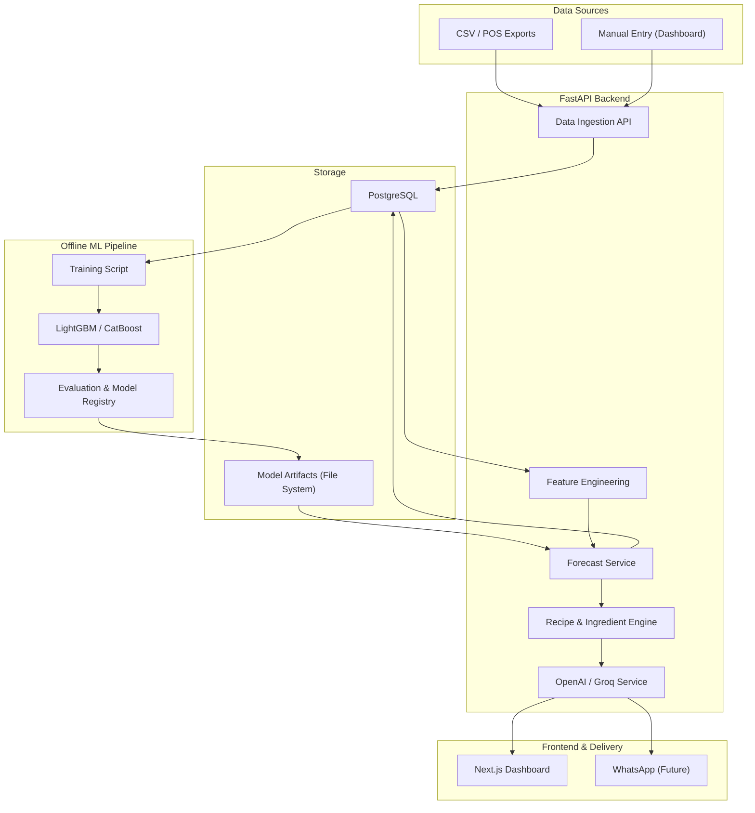
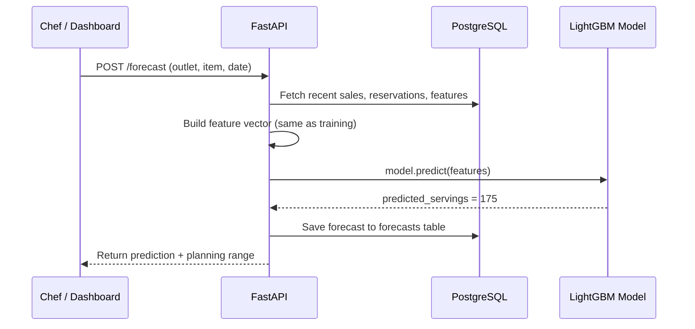
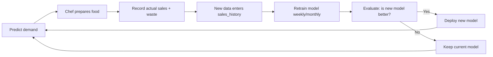

# Kitchen Control Tower — Build Plan

> **Goal:** Build a SaaS product that predicts restaurant food demand, calculates exact ingredient quantities, and delivers daily prep sheets — reducing food waste and saving money for restaurants.

---

## Architecture Overview



---

## Phase 1: Database & Data Foundation

**Duration:** ~1 week  
**What you build:** PostgreSQL schema, sample data, and CSV import script

### 1.1 — Set up PostgreSQL

Install PostgreSQL locally. Create a database called `kitchen_control_tower`.

### 1.2 — Create the database tables

| Table | Purpose | Key Columns |
|---|---|---|
| `tenants` | Restaurant accounts | `id`, `name`, `plan`, `created_at` |
| `outlets` | Kitchen locations per restaurant | `id`, `tenant_id`, `name`, `address` |
| `menu_items` | Dishes the restaurant sells | `id`, `tenant_id`, `name`, `category` |
| `sales_history` | Past daily sales per dish | `id`, `outlet_id`, `menu_item_id`, `date`, `quantity_sold`, `revenue`, `stockout` |
| `reservations` | Booking / cover data | `id`, `outlet_id`, `date`, `expected_covers` |
| `recipes` | Recipe definitions | `id`, `menu_item_id`, `version`, `yield_servings` |
| `recipe_ingredients` | Ingredients per recipe | `id`, `recipe_id`, `ingredient_name`, `quantity_per_serving`, `unit` |
| `inventory_snapshots` | Current stock levels | `id`, `outlet_id`, `ingredient_name`, `available_qty`, `unit`, `snapshot_date` |
| `forecasts` | Saved predictions | `id`, `outlet_id`, `menu_item_id`, `forecast_date`, `predicted_qty`, `model_version`, `created_at` |
| `prep_records` | What was actually prepared | `id`, `outlet_id`, `menu_item_id`, `date`, `prepared_qty`, `consumed_qty`, `waste_qty` |
| `model_registry` | Trained model metadata | `id`, `tenant_id`, `model_type`, `version`, `mae`, `training_window`, `artifact_path`, `is_active`, `created_at` |

> [!IMPORTANT]
> Every table that holds restaurant-specific data must include `tenant_id` or reference a table that does. Always filter by `tenant_id` in queries.

### 1.3 — Create sample / seed data

Generate **realistic fake data** for one restaurant:
- 6 months of daily sales for 5 dishes (Chicken Biryani, Paneer Curry, Naan, Dal Fry, Gulab Jamun)
- Weekend sales ~30-50% higher than weekday
- Random variation ±15%
- A few stockout days marked
- Recipe/BOM data for each dish
- Inventory snapshots for the current week

### 1.4 — Build CSV import endpoint

A FastAPI endpoint (`POST /api/v1/sales/import`) that:
1. Accepts a CSV file upload
2. Validates columns: `date`, `item_name`, `quantity_sold`
3. Maps item names to `menu_item_id`
4. Inserts validated rows into `sales_history`
5. Returns a summary: rows imported, rows skipped, errors

### Deliverable checklist — Phase 1
- [ ] PostgreSQL running with all tables created
- [ ] Seed script that populates 6 months of sample data
- [ ] FastAPI project initialized with database connection
- [ ] CSV import endpoint working

---

## Phase 2: ML Training Pipeline (Offline)

**Duration:** ~1–2 weeks  
**What you build:** Feature engineering, model training, evaluation, and model saving — all as Python scripts you run manually or on a schedule

### 2.1 — Feature engineering script

File: `ml/build_dataset.py`

Read from `sales_history` and build a training DataFrame with these features:

| Feature | How to calculate | Why it matters |
|---|---|---|
| `day_of_week` | 0=Monday … 6=Sunday | Captures weekly patterns |
| `is_weekend` | 1 if Saturday/Sunday | Weekend demand spikes |
| `month` | 1–12 | Seasonal trends |
| `day_of_month` | 1–31 | Payday effects |
| `lag_1` | Same dish, 1 day ago | Recent trend |
| `lag_7` | Same dish, 7 days ago | Same-weekday comparison |
| `rolling_mean_7` | Average of last 7 days | Short-term average |
| `rolling_mean_28` | Average of last 28 days | Monthly baseline |
| `reservations` | Expected covers for the date | Forward-looking signal |
| `had_stockout_prev` | Did the dish stock out yesterday? | Adjusts for censored demand |

**Target column (y):** `quantity_sold`

> [!WARNING]
> Never use future information as a feature. When calculating `lag_1` for a given date, use only data available *before* that date. This is the most common mistake in demand forecasting.

### 2.2 — Chronological train/validation/test split

```
|<---- Training ---->|<-- Validation -->|<--- Test --->|
   Month 1–4              Month 5            Month 6
```

- **Training set:** Oldest 4 months — the model learns from this
- **Validation set:** Month 5 — used to tune hyperparameters
- **Test set:** Month 6 — final accuracy check, never touched during training

> [!IMPORTANT]
> Use chronological splits, NOT random splits. In time-series forecasting, random splits leak future information and give misleadingly good results.

### 2.3 — Train three models

File: `ml/train.py`

```
┌─────────────────────────────────┐
│  Model 1: Weekday Baseline      │
│  Predict = avg of last 4 same   │
│  weekdays for that dish          │
├─────────────────────────────────┤
│  Model 2: LightGBM              │
│  Gradient-boosted decision trees │
│  Good for structured tabular     │
│  data with numeric features      │
├─────────────────────────────────┤
│  Model 3: CatBoost              │
│  Similar to LightGBM but handles │
│  categorical features natively   │
└─────────────────────────────────┘
```

**Why three?** The baseline tells you whether ML adds value. If LightGBM/CatBoost can't beat "average of recent same weekdays," the ML model isn't worth deploying.

**Training code structure:**

```python
# Pseudocode — ml/train.py

# 1. Load the prepared dataset
df = load_training_data()

# 2. Split chronologically
X_train, y_train = df[df.date < '2026-05-01'][features], ...
X_val,   y_val   = df[df.date between May][features], ...

# 3. Train LightGBM
lgb_model = lgb.LGBMRegressor(n_estimators=300, learning_rate=0.05)
lgb_model.fit(X_train, y_train)

# 4. Train CatBoost
cat_model = CatBoostRegressor(iterations=300, learning_rate=0.05)
cat_model.fit(X_train, y_train)

# 5. Save both models
lgb_model.booster_.save_model("artifacts/lgb_v001.txt")
cat_model.save_model("artifacts/cat_v001.cbm")
```

### 2.4 — Evaluate and compare

File: `ml/evaluate.py`

Run all three models on the **test set** (Month 6) and compare:

| Metric | What it measures |
|---|---|
| **MAE** (Mean Absolute Error) | Average servings the forecast was off |
| **WAPE** (Weighted Absolute % Error) | % error weighted by volume — high-demand dishes matter more |
| **Stockout rate** | How often would you have run out? |
| **Waste estimate** | How much would you have over-prepared? |

Example output:

| Model | MAE | WAPE |
|---|---|---|
| Weekday Baseline | 12.3 | 14.1% |
| LightGBM | 7.8 | 9.2% |
| CatBoost | 8.1 | 9.5% |

→ **Deploy LightGBM v001** because it has the lowest error.

### 2.5 — Register the winning model

Save metadata to the `model_registry` table:
- Model type, version, MAE, WAPE
- Training window (which dates were used)
- Artifact file path
- Set `is_active = true`

### Deliverable checklist — Phase 2
- [ ] `ml/build_dataset.py` — generates features from sales_history
- [ ] `ml/train.py` — trains baseline, LightGBM, CatBoost
- [ ] `ml/evaluate.py` — compares all models on test data
- [ ] Trained model files saved in `artifacts/`
- [ ] Model metadata saved to `model_registry`
- [ ] You can explain which model won and why

---

## Phase 3: FastAPI Prediction & Ingredient Engine

**Duration:** ~1 week  
**What you build:** API endpoints that load the trained model, predict demand, calculate ingredients, and save results

### 3.1 — Forecast endpoint

`POST /api/v1/forecast`

```
Request                              Response
─────────                            ─────────
{                                    {
  "outlet_id": 1,                      "forecast_date": "2026-10-23",
  "menu_item_id": 3,                   "menu_item": "Chicken Biryani",
  "forecast_date": "2026-10-23"        "predicted_servings": 175,
}                                      "planning_range": {
                                          "low": 155,
                                          "high": 195
                                       },
                                       "model_version": "lgb_v001"
                                    }
```

**What happens inside:**



> [!IMPORTANT]  
> The feature vector you build at prediction time **must have the exact same columns, in the exact same order** as the features used during training. Mismatched features are the #1 cause of wrong predictions in production.

### 3.2 — Recipe & ingredient calculation endpoint

`POST /api/v1/prep-sheet`

This is **deterministic math** — no ML involved.

**Step-by-step calculation:**

```
Step 1: Get the forecast
  → Chicken Biryani: 175 servings

Step 2: Look up the recipe (BOM)
  ┌──────────────┬──────────────┬────────┐
  │ Ingredient   │ Per Serving  │ Unit   │
  ├──────────────┼──────────────┼────────┤
  │ Raw Rice     │ 100 g        │ grams  │
  │ Raw Chicken  │ 180 g        │ grams  │
  │ Onions       │  20 g        │ grams  │
  │ Biryani Spice│   5 g        │ grams  │
  │ Oil          │  15 ml       │ ml     │
  └──────────────┴──────────────┴────────┘

Step 3: Calculate gross requirement
  Raw Rice    = 175 × 100g  = 17,500g = 17.5 kg
  Raw Chicken = 175 × 180g  = 31,500g = 31.5 kg
  Onions      = 175 ×  20g  =  3,500g =  3.5 kg

Step 4: Apply preparation buffer (e.g., 5%)
  Raw Rice    = 17.5 × 1.05 = 18.375 kg
  Raw Chicken = 31.5 × 1.05 = 33.075 kg
  Onions      =  3.5 × 1.05 =  3.675 kg

Step 5: Subtract usable inventory
  ┌──────────────┬──────────┬──────────┬──────────────┐
  │ Ingredient   │ Required │ In Stock │ To Procure   │
  ├──────────────┼──────────┼──────────┼──────────────┤
  │ Raw Rice     │ 18.4 kg  │  4.0 kg  │ 14.4 kg      │
  │ Raw Chicken  │ 33.1 kg  │  8.0 kg  │ 25.1 kg      │
  │ Onions       │  3.7 kg  │  1.0 kg  │  2.7 kg      │
  └──────────────┴──────────┴──────────┴──────────────┘
```

**Formula:**
```
to_procure = max(0, (predicted_servings × qty_per_serving × buffer) − usable_stock)
```

> [!CAUTION]
> Never let GPT/Groq calculate ingredient quantities. It can hallucinate numbers. The recipe engine must be pure Python math using verified recipe data from your database.

### 3.3 — Save actual outcomes endpoint

`POST /api/v1/actuals`

After service ends, record:
- `actual_quantity_sold`
- `prepared_quantity`
- `waste_quantity`
- `had_stockout` (yes/no)

This data feeds back into future training and proves your product's value.

### Deliverable checklist — Phase 3
- [ ] `/forecast` endpoint returns predictions from the trained model
- [ ] `/prep-sheet` endpoint calculates ingredients using recipe + stock
- [ ] `/actuals` endpoint records real outcomes for evaluation
- [ ] All forecasts saved to `forecasts` table with model version
- [ ] Feature vector matches training features exactly

---

## Phase 4: LLM Integration (OpenAI / Groq)

**Duration:** ~3–5 days  
**What you build:** GPT/Groq formats the verified prep-sheet data into chef-friendly messages

### 4.1 — What GPT/Groq does (and doesn't do)

| GPT/Groq DOES | GPT/Groq DOES NOT |
|---|---|
| Format prep-sheet into natural language | Predict demand numbers |
| Interpret chef messages like "add 20 extra covers" | Calculate ingredient quantities |
| Generate summary reports | Replace LightGBM forecasts |
| Translate between languages | Make recipe decisions |

### 4.2 — Implementation

```python
# services/llm_service.py

def generate_prep_message(forecast_data: dict) -> str:
    """
    Takes VERIFIED numbers from forecast + recipe engine.
    GPT only formats them into a readable message.
    """
    prompt = (
        "You are a kitchen assistant. Format the following verified "
        "forecast data into a clear, concise prep sheet for a chef. "
        "Do NOT change any numbers. Use the exact quantities provided.\n\n"
        f"{json.dumps(forecast_data, indent=2)}"
    )

    response = client.chat.completions.create(
        model="llama-3.3-70b-versatile",  # Groq free tier
        messages=[{"role": "user", "content": prompt}],
    )
    return response.choices[0].message.content
```

### 4.3 — API key management

```
# .env file (NEVER commit this to Git)
GROQ_API_KEY=gsk_your_key_here
OPENAI_API_KEY=sk-your_key_here    # for production later
LLM_PROVIDER=groq                   # switch to "openai" when ready
```

### Deliverable checklist — Phase 4
- [ ] Groq API connected and generating formatted prep sheets
- [ ] LLM service is a wrapper — all numbers come from your engine
- [ ] API key stored in `.env`, not in code
- [ ] Can switch between Groq (free testing) and OpenAI (production)

---

## Phase 5: Next.js Dashboard

**Duration:** ~1–2 weeks  
**What you build:** A web dashboard for restaurant managers and chefs

### 5.1 — Core pages

| Page | Purpose |
|---|---|
| **Login** | Tenant-scoped authentication |
| **Dashboard** | Today's forecast summary, charts, key metrics |
| **Forecast** | Select date + dishes → view predicted demand |
| **Prep Sheet** | Full ingredient breakdown with procurement list |
| **Sales Entry** | Upload CSV or manually enter today's actual sales |
| **History** | Compare forecast vs actual over time (accuracy chart) |
| **Recipes** | View/edit BOM for each dish |
| **Inventory** | Update current stock levels |

### 5.2 — Key dashboard elements

```
┌─────────────────────────────────────────────────────────┐
│  Kitchen Control Tower — Saturday, 23 Oct 2026          │
├────────────┬────────────┬────────────┬──────────────────┤
│ Total      │ Forecast   │ Yesterday  │ Model            │
│ Dishes: 5  │ Accuracy   │ Waste      │ Accuracy         │
│            │ 91.2%      │ 3.2 kg     │ MAE: 7.5         │
├────────────┴────────────┴────────────┴──────────────────┤
│                                                         │
│  Tomorrow's Forecast                                    │
│  ┌──────────────────┬──────────┬───────────────┐       │
│  │ Dish             │ Forecast │ Prep Range    │       │
│  ├──────────────────┼──────────┼───────────────┤       │
│  │ Chicken Biryani  │ 175      │ 155 – 195     │       │
│  │ Paneer Curry     │  90      │  78 – 102     │       │
│  │ Naan             │ 320      │ 290 – 350     │       │
│  │ Dal Fry          │ 110      │  95 – 125     │       │
│  │ Gulab Jamun      │  65      │  55 –  75     │       │
│  └──────────────────┴──────────┴───────────────┘       │
│                                                         │
│  [📋 Generate Prep Sheet]  [📤 Send to WhatsApp]       │
└─────────────────────────────────────────────────────────┘
```

### Deliverable checklist — Phase 5
- [ ] Next.js app with authentication
- [ ] Dashboard showing forecast summary
- [ ] Prep sheet page with ingredient calculations
- [ ] Sales entry (CSV upload + manual)
- [ ] Forecast vs actual accuracy chart
- [ ] Connected to FastAPI backend

---

## Phase 6: Feedback Loop & Retraining

**Duration:** ~3–5 days  
**What you build:** The system that makes your product smarter over time

### 6.1 — The feedback loop



### 6.2 — Retraining rules

| Rule | Details |
|---|---|
| **When to retrain** | Weekly, or when 200+ new sales records are available |
| **How to validate** | New model must beat current model's MAE on the latest holdout period |
| **How to deploy** | Update `model_registry.is_active`, point inference to new artifact |
| **Rollback** | Keep previous 2 model versions; revert if production accuracy drops |

### Deliverable checklist — Phase 6
- [ ] Actuals data flows back into `sales_history`
- [ ] Retraining script uses latest data
- [ ] New model compared against current model before deployment
- [ ] Model version tracked in every forecast record

---

## Phase 7: WhatsApp Integration (Future)

**Duration:** ~1 week  
**What you build:** Daily prep-sheet delivery via WhatsApp Business API

This is a future enhancement. Build it after Phases 1–6 are working and validated with real restaurant data.

---

## Project Structure — Final

```
kitchen-control-tower/
├── backend/
│   ├── app/
│   │   ├── main.py                 # FastAPI app entry
│   │   ├── config.py               # Environment config
│   │   ├── api/
│   │   │   ├── auth.py             # Login, tenant scoping
│   │   │   ├── sales.py            # CSV import, manual entry
│   │   │   ├── forecasts.py        # /forecast endpoint
│   │   │   ├── prep_sheets.py      # /prep-sheet endpoint
│   │   │   ├── inventory.py        # Stock management
│   │   │   ├── recipes.py          # BOM/recipe CRUD
│   │   │   └── actuals.py          # Record outcomes
│   │   ├── services/
│   │   │   ├── feature_engineering.py
│   │   │   ├── forecasting.py      # Loads model, predicts
│   │   │   ├── recipe_calculator.py # Deterministic math
│   │   │   └── llm_service.py      # GPT/Groq formatting
│   │   ├── db/
│   │   │   ├── models.py           # SQLAlchemy models
│   │   │   ├── session.py          # DB connection
│   │   │   └── migrations/         # Alembic migrations
│   │   └── schemas/
│   │       └── *.py                # Pydantic request/response
│   ├── ml/
│   │   ├── build_dataset.py        # Feature engineering
│   │   ├── train.py                # Train all models
│   │   ├── evaluate.py             # Compare & select best
│   │   └── predict.py              # Reusable prediction fn
│   ├── artifacts/                  # Trained model files (gitignored)
│   ├── seed/
│   │   └── generate_sample_data.py
│   ├── tests/
│   ├── requirements.txt
│   ├── .env                        # API keys (gitignored)
│   └── .gitignore
│
├── frontend/
│   ├── src/
│   │   ├── app/                    # Next.js pages
│   │   ├── components/
│   │   └── lib/                    # API client
│   ├── package.json
│   └── ...
│
└── README.md
```

---

## Build Order — Summary

| Phase | What | Duration | Key Output |
|---|---|---|---|
| **1** | Database + seed data + CSV import | ~1 week | PostgreSQL with 6 months of sample data |
| **2** | ML training pipeline | ~1–2 weeks | Trained LightGBM model beating baseline |
| **3** | FastAPI forecast + ingredient engine | ~1 week | Working API that predicts and calculates |
| **4** | LLM integration (Groq free tier) | ~3–5 days | Formatted prep sheets via Groq API |
| **5** | Next.js dashboard | ~1–2 weeks | Web UI for restaurant managers |
| **6** | Feedback loop + retraining | ~3–5 days | System that improves with real data |
| **7** | WhatsApp delivery | ~1 week | Daily prep-sheet messages |

> [!TIP]
> **Start with Phases 1–3.** These give you a working forecast engine that you can test with real data. Don't build the dashboard or WhatsApp integration until your predictions are actually accurate. The ML pipeline is the foundation — everything else is presentation.

---

## What You Need Installed

| Tool | Purpose | Cost |
|---|---|---|
| Python 3.10+ | Backend + ML | Free |
| PostgreSQL 15+ | Database | Free |
| Node.js 18+ | Next.js frontend | Free |
| LightGBM | Demand forecasting | Free (MIT licence) |
| CatBoost | Alternative forecasting | Free (Apache 2.0) |
| Groq API | LLM for testing | Free tier |
| OpenAI API | LLM for production | Pay-per-use |

---

> [!NOTE]
> **Your biggest risk is not the architecture — it's the data.** A perfectly built system with bad or insufficient sales data will produce bad forecasts. Start collecting real restaurant sales data as early as possible, even if it's just CSV exports from their POS system.
